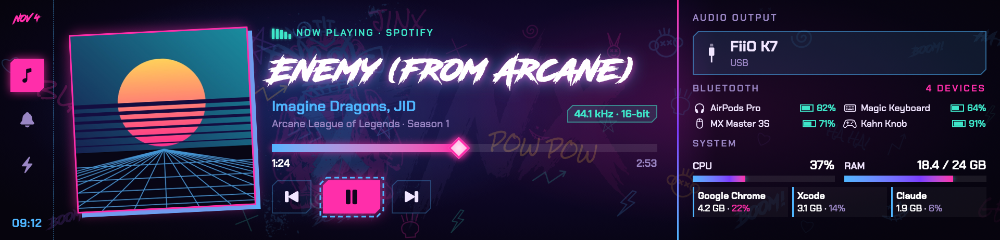

# LJ Display

A native Swift menu-bar app for macOS that drives the **Jungle Leopard 9.16" USB LCD** (HONGTAI `MONITOR`,
USB `33c3:7792`, 1920×462) as a second screen for the Mac. The vendor only ships a Windows app. LJ Display renders
a SwiftUI dashboard at 60 fps and streams it to the panel over USB.



## Goal

Turn the 9.16" bar panel into an always-on status strip for a Mac:

- **Music**: what is playing (any app, via MediaRemote), artwork, progress, sample rate / bit depth of the output
  device, and play / pause / seek / next / previous from hot keys or a knob board.
- **Rail** (always visible): the current audio output, Bluetooth devices with battery levels, CPU / RAM and the top
  processes.
- **Notifications** and **AI usage** (Claude / Codex quotas) pages. These are placeholders for now (see
  [Roadmap](#roadmap)).

Other goals: no driver, no Xcode, no root. The panel is found automatically, and the app reconnects after unplug,
sleep / wake and restarts. It runs at 60 fps while anything animates and sends no frames while the screen is static,
within a small CPU budget.

## Requirements

- macOS 14 or later, Apple Silicon (the Makefile and `Package.swift` use the `/opt/homebrew` paths).
- Xcode Command Line Tools with Swift 6 (`xcode-select --install`). Xcode itself is not needed.
- libjpeg-turbo: `brew install jpeg-turbo`. It is linked statically, so the built app does not need Homebrew at run
  time.
- A Jungle Leopard / HONGTAI 9.16" panel on a USB 2.0 High Speed port (USB `33c3:7792`; `7788` is also accepted).

## Build and run

```sh
git clone https://github.com/daitran111092/leopard-jungle-display-macos.git
cd leopard-jungle-display-macos

make test                  # whole test suite (Swift Testing)
make app                   # → dist/LJ Display.app (release build, ad-hoc signed)
open "dist/LJ Display.app"
```

`make app` also builds the vendored `MediaRemoteAdapter.framework` (`scripts/build-adapter.sh`) and copies it into the
bundle. The bundle id is `vn.kahn.ljdisplay`, and the app is `LSUIElement`: it has no Dock icon. Look for its
menu-bar item (two stacked rectangles). The app always starts on the **Music** page.

For a permanent install, copy the app to `/Applications`.

If the panel is mounted upside down, run `defaults write vn.kahn.ljdisplay rotateCW -bool YES` and restart the app.

### Hardware probes (`ljprobe`)

`ljprobe` is a CLI for checking the hardware and the data sources without the app:

```sh
swift run ljprobe panel [--watch | --soak SECONDS]       # find the panel, getInfo, stream a test pattern
swift run ljprobe audio|bt|sys [--seconds N]             # print the rail sources
swift run ljprobe np [next | prev | toggle | seek S]     # now-playing stream / commands
swift run ljprobe keys                                   # print the hot keys as they are pressed
swift run ljprobe stream [--demo] [--warn]               # the full live dashboard, logged to the terminal
make fixtures                                            # render every UI fixture to out/fixtures/*.png
```

The `make` targets pass the Command Line Tools framework flags that Swift Testing needs. If a plain `swift run` fails
to link, use `make probe` or copy `SWIFTFLAGS` from the Makefile.

## Menu

- **Status**: `Connected · <fps> fps` or `Panel not found`.
- **Brightness**: 20 / 40 / 60 / 80 / 100 %. Applied at once and after every reconnect, and saved to the config.
- **Theme**: Jinx 50/50, or Jinx 70% blue. Saved to the config.
- **Pause streaming**: the panel keeps the last frame and no new frames are rendered (the 60 Hz timer is suspended).
- **Open Config**: opens `config.json`.
- **Launch at Login**: uses `SMAppService.mainApp`. See the note below.
- **Quit** (⌘Q): sends the panel's CLEAR sequence, then closes the port. `kill <pid>` (SIGTERM) does the same.

### Launch at Login

`SMAppService.mainApp` registers the app bundle as a login item. This app is only ad-hoc signed, so macOS can refuse
the registration or ask for approval. That is most likely when the app runs from `dist/` rather than from
`/Applications`. The app does not crash when this happens:

- if the registration fails, the menu item reads `Launch at Login (failed: …)` and the error goes to the log;
- if macOS wants approval, the item reads `Launch at Login (approve in System Settings › Login Items)`.

For a reliable login item, copy the app to `/Applications` first and toggle the item from there. If macOS still
refuses, add the app by hand in System Settings › General › Login Items.

## Config

The config file is `~/Library/Application Support/LJ Display/config.json`. It is created with the defaults on the
first launch:

```json
{
  "accounts" : [],
  "brightness" : 80,
  "maxFps" : 60,
  "shortcuts" : { "turnLeft" : ["F13", "Ctrl+Option+Left"], "turnRight" : ["F14", "Ctrl+Option+Right"],
                  "press" : ["F15", "Ctrl+Option+Return"], "k1" : ["F16", "Ctrl+Option+["],
                  "k2" : ["F17", "Ctrl+Option+]"], "k3" : ["F18"], "k3Hold" : ["Shift+F18"],
                  "nextPage" : ["F19", "Ctrl+Option+Down"], "prevPage" : ["Shift+F19", "Ctrl+Option+Up"] },
  "theme" : "jinx"
}
```

- Any key you leave out takes its default value. Inside `shortcuts`, each action you leave out keeps its default
  keys. An action you list gets exactly the keys in its array.
- Older configs with one string per action (`"turnLeft" : "F13"`) still load: each string becomes that key plus the
  action's Ctrl+Option fallback. A `press` binding of `Ctrl+Option+Space` becomes `Ctrl+Option+Return`, because macOS
  uses Ctrl+Option+Space for "Select next input source". The file is not rewritten until the menu saves a change.
- If the file is not valid JSON, or a value has the wrong type, the app copies it to `config.json.bak` and runs with
  the defaults.
- `theme`: `jinx` or `jinx-blue`. `brightness`: 0–100. `maxFps`: 1–60 (the frame-loop timer rate).
- Shortcut keys are `F13`…`F19`, optionally with a `Shift+` prefix, or `Ctrl+Option+` with `Left`, `Right`, `Up`,
  `Down`, `Space`, `Return`, `[` or `]` (case-insensitive; `Opt` / `Alt` also work). A key that macOS or another app
  already owns is skipped and logged (`keys: registered N/M, failed …`). Relaunch the app after editing shortcuts or
  `maxFps`. The menu changes brightness and theme live.
- `accounts` is a list of `{ "provider": "claude-oauth" | "codex", "configDir": "~/.claude", "label": "Work" }` for
  the AI usage page. `configDir` points at the provider's own credentials directory. The app reads it at runtime and
  never copies tokens into the config or the log. The list is ignored until the AI page lands.
- The config never holds tokens or passwords.

## Knob board shortcuts

Map the knob board's controls to these keys (defaults; change them in `shortcuts`). The Ctrl+Option fallbacks are
for keyboards without F13–F19:

| Control | Key | Fallback | Action | Effect |
|---|---|---|---|---|
| Knob turn left | F13 | Ctrl+Option+← | `turnLeft` | Music: seek back 5 s |
| Knob turn right | F14 | Ctrl+Option+→ | `turnRight` | Music: seek forward 5 s |
| Knob press | F15 | Ctrl+Option+Return | `press` | Music: play / pause |
| Key 1 | F16 | Ctrl+Option+[ | `k1` | Music: previous track |
| Key 2 | F17 | Ctrl+Option+] | `k2` | Music: next track |
| Key 3 | F18 | — | `k3` | (page action) |
| Key 3 hold | Shift+F18 | — | `k3Hold` | (page action, long) |
| Next page | F19 | Ctrl+Option+↓ | `nextPage` | slide to the next page |
| Previous page | Shift+F19 | Ctrl+Option+↑ | `prevPage` | slide to the previous page |

Music controls act only on the Music page and only while something is playing or paused. Rapid knob turns are
merged: the app sends one seek per 250 ms with the latest target. Play / pause and seeks show on the panel at once
and hold for up to 1.5 s, until the player confirms them. If the player never confirms, the panel goes back to what
the player reports. A command that hangs is stopped after 3 s.

Debug: launch with `open --env LJ_DEBUG_ACTIONS=1 "dist/LJ Display.app"`, then
`notifyutil -p vn.kahn.ljdisplay.debug.<action>` (e.g. `…debug.press`) runs that action as if its key were pressed.

## Logs and performance

The app logs to `~/Library/Logs/LJ Display/LJ Display.log`, and keeps the previous run's log as `LJ Display.log.1`.
A stats line (fps, CPU, footprint, render/encode ms, JPEG size) is written every 10 s. For a stats line every second,
launch with `open --env LJ_STATS_INTERVAL=1 "dist/LJ Display.app"`.

Budget: ≤ ~35 % of one core while animating at 60 fps, ≤ 20 fps when only ambient animation runs, ~0 when static,
and < 120 MB footprint.

## Sleep, unplug, quit

- **Unplug / replug**: the panel is rediscovered and reconnects within about 5 s.
- **Sleep**: the frame loop stops and the panel session closes before the Mac sleeps. On wake, discovery restarts and
  reconnects.
- **Quit**: the panel gets the CLEAR sequence before the port closes.

## How it works

```
sources (audio, Bluetooth, system, now playing, hot keys)
   → reducer → AppStore (state)
   → FrameLoop: SwiftUI ImageRenderer → rotate to 462×1920 → JPEG (libjpeg-turbo, q ≤ 0.95 within a 300 KB budget)
   → Panel session → USBBulkPort (one bulk OUT transfer per frame)
```

### Panel protocol

The panel enumerates as a CDC-ACM device, but LJ Display bypasses the tty and writes to the CDC data interface over
IOUSBHost. The macOS tty splits a frame into ~1 KB transfers, which the panel sometimes corrupts. One bulk transfer per
frame, as the Windows app does, fixed that.

- Control frame: `55 AA | len u16 LE | key u8 | payload | sum16 LE`, where `len = payload + 7` and `sum16` is the sum
  of all preceding bytes & 0xFFFF. Replies use the same framing with a JSON body.
- Opcodes in use: `0x06` getInfo, `0x03` brightness, `0x11` enter / keep live mode (sent again every 1.5 s).
  `0x01` restart, `0x0C` OTA, `0x20`, `0x23` and file writes are never sent.
- Image frame (firmware > 2.8): `len u32 LE | jpeg | sum16 LE`. The JPEG is 462×1920 portrait: the 1920×462 picture
  rotated, because the panel is mounted at angle 270.
- Clear: `FF D9 FF D9 00 00 00 00`.

## Project structure

| Path | Contents |
|---|---|
| `Sources/LJCore` | pure logic: types, panel protocol + session (`Panel`), reducer, frame budget, now-playing parsing, config (`AppConfig`, `loadConfig`) |
| `Sources/LJSources` | the outside world: USB bulk port, serial port, panel discovery (IOKit), audio / Bluetooth / system / now-playing sources, global hot keys |
| `Sources/LJUI` | SwiftUI views (`Views/`), theme, fonts, decor, `AppStore`, `FrameLoop`, `FrameEncoder` (libjpeg-turbo), bundled resources |
| `Sources/LJApp` | live wiring shared by the app and `ljprobe stream`: `PanelLink` (connect off main, reconnect), `LJRuntime` (sources → store → frame loop, hot keys → reducer, sleep / wake, CLEAR on quit), log, process meter |
| `Sources/LJDisplay` | the `.app` executable: `main.swift`, `MenuBar.swift`, `Effects.swift` |
| `Sources/ljprobe` | hardware probe CLI |
| `Sources/CTurboJPEG` | system-library module map for libjpeg-turbo |
| `Tests/` | one test target per library (Swift Testing), with JSON fixtures in `Tests/LJCoreTests/Fixtures` |
| `vendor/mediaremote-adapter` | vendored [ungive/mediaremote-adapter](https://github.com/ungive/mediaremote-adapter) (commit in `UPSTREAM_COMMIT`) |
| `scripts/` | `build-adapter.sh` (adapter framework, no cmake), `make-app.sh` (app bundle + signing) |
| `Resources/Info.plist` | app bundle Info.plist |

`LJCore` has no dependencies, so the logic can be tested without hardware.

## Contributing

1. Fork, then branch from `main` (`feat/…`, `fix/…`).
2. Keep the layering: protocol and state logic go in `LJCore`, anything that touches IOKit / CoreAudio / Bluetooth
   goes in `LJSources`, views go in `LJUI`, and wiring goes in `LJApp`.
3. Add or update tests next to the code you change, and run `make test`. All tests must pass.
4. For UI changes, add a case to `Sources/LJUI/Fixtures.swift` if needed, run `make fixtures`, and check the PNGs in
   `out/fixtures/`. Attach a before / after picture to the PR.
5. For panel or transport changes, test on real hardware with `ljprobe panel --soak 60` and `ljprobe stream`, and
   check the stats line in the log (fps, frame gaps / late frames, JPEG size).
6. Never add opcodes that write to the panel's flash (restart, OTA, region, serial, file writes).
7. Use [Conventional Commits](https://www.conventionalcommits.org/) (`feat:`, `fix:`, `refactor:` …) and open a PR
   against `main`.

To update the vendored adapter, copy the new upstream sources into `vendor/mediaremote-adapter`, update
`UPSTREAM_COMMIT`, and run `make app` and `swift run ljprobe np` to check that now playing still works.

## Roadmap

- **Notifications** page: reads the macOS notification database, which needs Full Disk Access (System Settings ›
  Privacy & Security › Full Disk Access → add `LJ Display.app`, then relaunch).
- **AI usage** page: Claude and Codex quota bars from the accounts in the config.
- A Bluetooth knob + keys board to drive the hot keys.

## Credits

The panel protocol and the hardware notes come from these projects:

- [nickadam/jungle-leopard](https://github.com/nickadam/jungle-leopard): Linux utility for the Jungle Leopard 9.16"
  USB display (MIT).
- [kechie/hongtai-panel](https://github.com/kechie/hongtai-panel): Linux driver for the HONGTAI `MONITOR` LCD
  (`33c3:7791`) used in LovingCool AIO coolers.
- [hieubui2409/pc-screens](https://github.com/hieubui2409/pc-screens): animated system dashboards for the Lian Li
  8.8" and Jungle Leopard in-case screens on Linux.

Libraries and assets:

- [ungive/mediaremote-adapter](https://github.com/ungive/mediaremote-adapter): now-playing access and media control
  on current macOS (BSD 3-Clause, vendored in `vendor/mediaremote-adapter`).
- [libjpeg-turbo](https://libjpeg-turbo.org/): JPEG encoding.
- Fonts: [Be Vietnam Pro](https://github.com/bettergui/BeVietnamPro) and
  [Chakra Petch](https://github.com/m4rc1e/Chakra-Petch) (SIL OFL 1.1), Rock Salt (Apache 2.0), and SVN-Road Rage
  (D3design's Vietnamese version of Road Rage by Youssef Habchi, **free for personal use only**). Each font's license
  is next to it in `Sources/LJUI/Resources/Fonts/`.
- The visual style is inspired by Jinx from *Arcane* / League of Legends. Jinx, *Arcane* and League of Legends are
  trademarks of Riot Games. This is an unofficial fan project, not affiliated with Riot Games or the panel maker.

If you redistribute builds, check the font licenses first: SVN-Road Rage does not allow commercial use.
